# TV Agent Launcher Documentation Hub

Welcome to the technical documentation for **TV Agent Launcher** (`tv-agent-launcher`).

This documentation hub is organized specifically for **codebase comprehension, architecture exploration, and developer onboarding**.

---

## 📚 Documentation Sitemap

```mermaid
flowchart TD
    Root["Documentation Hub (docs/README.md)"]

    Root --> Arch["1. Architecture & Core Design"]
    Arch --> Arch1["overview.md (Feature-First & Vertical Slicing)"]
    Arch --> Arch2["state-management-mvi.md (MVI & Flow Pattern)"]
    Arch --> Arch3["coding-standards.md (Rules, Constraints, CI Gate)"]

    Root --> Mod["2. Feature Modules (Codebase Navigation)"]
    Mod --> Mod1["home.md (MainActivity, 10 Coordinators, Grid & Dock)"]
    Mod --> Mod2["smarthome.md (HassClient, SmartHomeSheet, Clean Arch)"]
    Mod --> Mod3["agent.md (Duinch AI Bot, Voice, WebSocket)"]
    Mod --> Mod4["notification.md (TvNotification, In-Window Sheet, HUD)"]
    Mod --> Mod5["runningapps.md (RAM Monitor, Task Killer)"]
    Mod --> Mod6["system.md (Hardware Metrics, Remote Keys, Screensaver)"]
    Mod --> Mod7["settings.md (In-Window SideSheets, App Library, OTA)"]

    Root --> Guide["3. Developer Guides & Operations"]
    Guide --> Guide1["developer-onboarding.md (Build, Test, Debug)"]
    Guide --> Guide2["tvctl-and-remote.md (tvctl CLI, Tailscale ADB)"]
    Guide --> Guide3["camera-streaming.md (RTSP Tapo & Go2rtc)"]
    Guide --> Guide4["troubleshooting.md (Hardware & Connection Matrix)"]
```

---

## 1. Architecture & Core Design

Understand the structural foundation of the launcher:

- 🏗️ **[Architecture Overview](architecture/overview.md)**:
  System mission, low-RAM constraints (1 GB RAM target), single-activity design, and the **Feature-First / Vertical Slicing** pattern.
- 🔄 **[State Management & MVI Pattern](architecture/state-management-mvi.md)**:
  Unidirectional Data Flow (UDF), `Intent` -> `Presenter` -> `State`/`Effect` -> `View/Sheet`, with 100% Kotlin Coroutines and `StateFlow`.
- 📏 **[Coding Standards & Constraints](architecture/coding-standards.md)**:
  Hard rules: files $< 300$ lines, lines $\le 100$ characters, 0 `typealias`, zero-allocation render paths, and the $< 700$ KB release APK CI gate.

---

## 2. Feature Modules (Deep Dives)

Detailed walkthrough of each vertical feature slice inside `apps/launcher/app/src/main/java/com/gathin/tvhome/feature/`:

- 🏠 **[Main Screen Module](modules/main.md)**:
  Decoupled [`MainActivity`](file:///Users/lap16792/Personal/tv-agent/tv-agent-launcher/apps/launcher/app/src/main/java/com/gathin/tvhome/feature/main/ui/MainActivity.kt) (272 lines), the 10 domain coordinators, TV Grid vs Desktop Dock mode, and live wallpapers.
- 💡 **[Smart Home Module](modules/smarthome.md)**:
  Direct Home Assistant integration via [`HassClient`](file:///Users/lap16792/Personal/tv-agent/tv-agent-launcher/apps/launcher/app/src/main/java/com/gathin/tvhome/feature/smarthome/datasource/HassClient.kt), `SmartHomeSheet`, room grouping, and device controls (climate, fan, light, switch).
- 🤖 **[AI Agent Module](modules/agent.md)**:
  Duinch animated companion bot ([`DuinchView`](file:///Users/lap16792/Personal/tv-agent/tv-agent-launcher/apps/launcher/app/src/main/java/com/gathin/tvhome/feature/agent/ui/DuinchView.kt)), WebSocket streaming protocol, speech recognition, and TV remote shortcut bindings.
- 🔔 **[Notification Module](modules/notification.md)**:
  [`TvNotification`](file:///Users/lap16792/Personal/tv-agent/tv-agent-launcher/apps/launcher/app/src/main/java/com/gathin/tvhome/feature/notification/model/TvNotification.kt) Clean Architecture repository, in-window history sheet, topbar unread dot, and floating heads-up display ([`NotificationHudOverlay`](file:///Users/lap16792/Personal/tv-agent/tv-agent-launcher/apps/launcher/app/src/main/java/com/gathin/tvhome/feature/notification/ui/NotificationHudOverlay.kt)).
- ⚡ **[Running Apps Module](modules/runningapps.md)**:
  Background task scanner, per-process RAM consumption, and the one-click "Clean RAM" optimization utility.
- ⚙️ **[System Module](modules/system.md)**:
  CPU/RAM hardware monitors, network quality observer, multi-vendor remote key mapper, and the Deep Ambient OLED screensaver ([`ClockDream`](file:///Users/lap16792/Personal/tv-agent/tv-agent-launcher/apps/launcher/app/src/main/java/com/gathin/tvhome/service/ClockDream.kt)).
- 🔧 **[Settings Module](modules/settings.md)**:
  Modular in-window side sheets ([`QuickSettingsSheet`](file:///Users/lap16792/Personal/tv-agent/tv-agent-launcher/apps/launcher/app/src/main/java/com/gathin/tvhome/feature/settings/ui/QuickSettingsSheet.kt), `LauncherSettingsSheet`, `AppLibraryDialog`), and OTA release updater.

---

## 3. Developer Guides & Operations

Practical references for building, debugging, and running the project:

- 🚀 **[Developer Onboarding](guides/developer-onboarding.md)**:
  Toolchain prerequisites (JDK 21, Android SDK 34), Gradle commands, 196+ unit tests, code style verification, and physical TV deployment.
- 📡 **[tvctl & Remote Management](guides/tvctl-and-remote.md)**:
  Using the Go-based `tvctl` tool, network ADB connection, guarded OEM debloating, and secure remote access over Tailscale.
- 📹 **[Camera Streaming Guide](guides/camera-streaming.md)**:
  RTSP configuration for IP cameras (Tapo) and integration into Home Assistant and TV views.
- 🛠️ **[Troubleshooting Guide](guides/troubleshooting.md)**:
  Resolving ADB network issues, OEM launcher conflicts (Xiaomi, Google TV `setupwraith`), and remote control mapping quirks.
