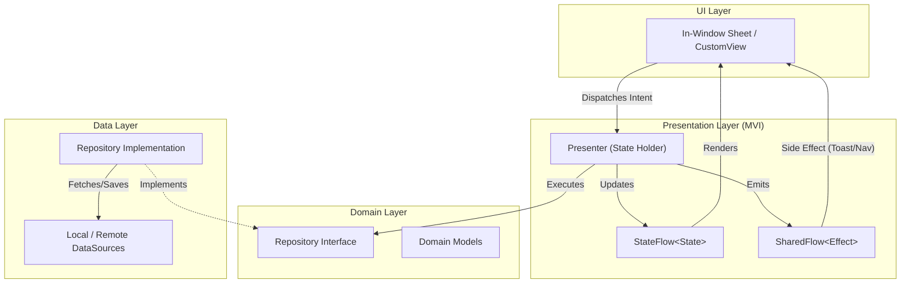

# Architecture Overview

`tv-agent-launcher` is a high-performance, low-footprint Android TV launcher designed specifically for resource-constrained smart TVs (e.g., 1 GB RAM, quad-core ARM Cortex-A35 / Realtek RTD288o platforms).

It combines a lean remote-driven TV home grid with an integrated **Vietnamese AI Assistant (Duinch)** and direct **Home Assistant (Hass)** smart home integration.

---

## 1. Core Engineering Principles

1. **Extreme Memory & APK Footprint**:
   - Release APK size is strictly constrained under **700 KB** (currently **~561 KB** / 575,221 bytes).
   - Zero heavy third-party dependencies: No Jetpack Compose, no Glide/Coil, no Dagger/Hilt, no Retrofit.
   - Built with native Android Views, custom Canvas drawables, and an in-house asynchronous [`ImageLoader`](file:///Users/lap16792/Personal/tv-agent/tv-agent-launcher/apps/launcher/app/src/main/java/com/gathin/tvhome/core/util/ImageLoader.kt) utilizing `ImageDecoder` and low-RAM memory policies.

2. **Single-Activity Architecture**:
   - The entire UI is hosted inside [`MainActivity`](file:///Users/lap16792/Personal/tv-agent/tv-agent-launcher/apps/launcher/app/src/main/java/com/gathin/tvhome/feature/main/ui/MainActivity.kt).
   - All sub-screens (Settings, Smart Home, Notifications, Running Apps) open as in-window floating dialog sheets ([`SideSheet`](file:///Users/lap16792/Personal/tv-agent/tv-agent-launcher/apps/launcher/app/src/main/java/com/gathin/tvhome/core/view/SideSheet.kt)). This eliminates Android Activity transition overhead, prevents process churn, and keeps input latency below 20ms.

3. **Feature-First / Vertical Slicing**:
   - Codebase is organized by domain features rather than horizontal technical layers.
   - Each feature encapsulates its own models, data sources, repositories, presentation logic (MVI), and UI components.

---

## 2. High-Level Directory Structure

```text
com.gathin.tvhome/
├── core/                               # Cross-cutting foundational modules
│   ├── design/                         # Material 3 palette, shapes, badges, drawables
│   ├── motion/                         # Spring animations, focus navigation, scroll physics
│   ├── view/                           # Common UI widgets (SideSheet, NativeMarkdown, GlassView)
│   └── util/                           # Coroutine lifecycle helpers, ImageLoader, SoundEffects
│
├── feature/                            # Unified Vertical Feature Slices (Standardized Structure)
│   ├── home/                           # adapter/, coordinator/, widget/, data/, presenter/, ui/
│   ├── smarthome/                      # widget/, data/, presenter/, ui/
│   ├── notification/                   # widget/, data/, presenter/, ui/
│   ├── runningapps/                    # data/, presenter/, ui/
│   ├── agent/                          # adapter/, coordinator/, widget/, data/, ui/
│   ├── system/                         # coordinator/, widget/, data/, ui/
│   └── settings/                       # widget/, data/, ui/
│
├── receiver/                           # Package installation / system broadcast receivers
├── service/                            # System services (InputKeyService, HomeKeyService, ClockDream)
└── Contract.java                       # Inter-process AIDL / IPC definitions
```

---

## 3. Standardized Package Layout Per Feature

To maximize developer ergonomics and consistency across the codebase, every feature strictly adheres to the unified layout established by `feature/main`:

| Package | Purpose & Contents |
|---|---|
| **`data/`** | All data concerns unified: Domain entities, models, local/remote data sources, and repositories. |
| **`presenter/`** | MVI State holders (`Presenter`) and MVI contracts (`Intent`, `State`, `Effect`). |
| **`ui/`** | Main entry screens, Activities, and in-window dialog sheets (`SideSheet`). |
| **`widget/`** | Feature-specific custom views, card renderers, and component sections. |
| **`coordinator/`** | Specialized feature coordinators, key handlers, or background managers. |
| **`adapter/`** | RecyclerView adapters, view holders, and list items (when applicable). |

---

## 3. Layer Separation Within Features

Each vertical feature under `feature/<name>` follows a clean separation of concerns:



---

## 4. Key Subsystems Overview

- **Core Foundation (`core/`)**:
  Contains reusable system primitives that do not belong to any single business feature. It has no dependencies on `feature/`.
- **Home Launcher (`feature/main/`)**:
  Hosts [`MainActivity`](file:///Users/lap16792/Personal/tv-agent/tv-agent-launcher/apps/launcher/app/src/main/java/com/gathin/tvhome/feature/main/ui/MainActivity.kt) which delegates UI orchestration to 10 specialized Coordinators (App, Grid, Header, TV Input, Cards, Theme, etc.).
- **Smart Home (`feature/smarthome/`)**:
  Communicates directly with Home Assistant instances over HTTP/REST via [`HassClient`](file:///Users/lap16792/Personal/tv-agent/tv-agent-launcher/apps/launcher/app/src/main/java/com/gathin/tvhome/feature/smarthome/datasource/HassClient.kt).
- **AI Agent (`feature/agent/`)**:
  Provides conversational TV assistant capabilities via WebSocket connection to a companion backend (`services/agent`).
- **System & Automation (`feature/system/`)**:
  Intercepts physical remote control keys, monitors CPU/RAM metrics, and hosts the deep-ambient screensaver ([`ClockDream`](file:///Users/lap16792/Personal/tv-agent/tv-agent-launcher/apps/launcher/app/src/main/java/com/gathin/tvhome/service/ClockDream.kt)).
