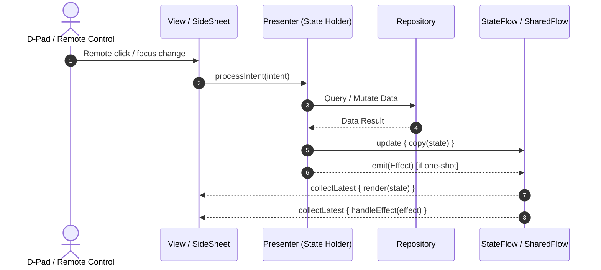

# State Management & MVI Pattern

To maintain predictable UI state, avoid race conditions, and support testability without relying on heavy third-party state libraries, `tv-agent-launcher` adopts the **Model-View-Intent (MVI)** architectural pattern with Kotlin **Coroutines & Flow**.

---

## 1. Unidirectional Data Flow (UDF)

The system enforces strict one-way data flow:



1. **User Action**: The user presses a D-Pad button or triggers a key event on the remote.
2. **Intent**: The UI creates a strongly-typed `Intent` and passes it to the `Presenter`.
3. **Business Execution**: The `Presenter` executes repository calls within the appropriate Coroutine dispatcher (`Dispatchers.IO` for disk/network, `Dispatchers.Main` for UI).
4. **State Emitted**: The `Presenter` updates an immutable `StateFlow<State>`.
5. **Effect Emitted**: One-shot side-effects (e.g., toast notification, opening system intent) are sent through a `SharedFlow<Effect>`.
6. **Render**: The View observes state changes and renders the UI incrementally.

---

## 2. The Core MVI Contracts

Every interactive screen and in-window sheet defines its MVI contract adhering to the following structure:

### A. Intent (User / System Actions)
Represents every action that can be initiated by the user or system triggers:
```kotlin
sealed interface SmartHomeIntent {
    object Load : SmartHomeIntent
    data class ToggleDevice(val device: SmartHomeDevice) : SmartHomeIntent
    data class AdjustClimate(val device: SmartHomeDevice, val temp: Float) : SmartHomeIntent
    data class Refresh(val force: Boolean = false) : SmartHomeIntent
}
```

### B. State (Immutable UI Representation)
A single immutable data class representing the entire UI status at any given time:
```kotlin
data class SmartHomeState(
    val isLoading: Boolean = false,
    val rooms: List<SmartHomeRoom> = emptyList(),
    val devices: List<SmartHomeDevice> = emptyList(),
    val errorMessage: String? = null
)
```

### C. Effect (One-Shot Events)
Events that should not be re-rendered when the screen redraws (such as showing a confirmation snackbar or launching an external app):
```kotlin
sealed interface SmartHomeEffect {
    data class ShowToast(val message: String) : SmartHomeEffect
    data class NavigateToSettings(val deviceId: String) : SmartHomeEffect
}
```

---

## 3. Presenter Implementation Example

A typical Presenter lifecycle and coroutine scoping:

```kotlin
class SmartHomePresenter(
    private val repository: SmartHomeRepository,
    private val scope: CoroutineScope
) {
    private val _state = MutableStateFlow(SmartHomeState())
    val state: StateFlow<SmartHomeState> = _state.asStateFlow()

    private val _effect = MutableSharedFlow<SmartHomeEffect>()
    val effect: SharedFlow<SmartHomeEffect> = _effect.asSharedFlow()

    fun processIntent(intent: SmartHomeIntent) {
        when (intent) {
            is SmartHomeIntent.Load -> loadDevices()
            is SmartHomeIntent.ToggleDevice -> toggle(intent.device)
            // ...
        }
    }

    private fun loadDevices() {
        scope.launch {
            _state.update { it.copy(isLoading = true, errorMessage = null) }
            repository.getDevices()
                .catch { e -> _state.update { it.copy(isLoading = false, errorMessage = e.message) } }
                .collect { list ->
                    _state.update { it.copy(isLoading = false, devices = list) }
                }
        }
    }
}
```

---

## 4. Where MVI Is Applied

MVI state holders govern every primary UI station across the launcher:

| Feature / Screen | Presenter | Contract |
|---|---|---|
| **Main Screen** | [`MainPresenter`](file:///Users/lap16792/Personal/tv-agent/tv-agent-launcher/apps/launcher/app/src/main/java/com/gathin/tvhome/feature/main/presenter/MainPresenter.kt) | `MainIntent`, `MainState`, `MainEffect` |
| **Smart Home** | [`SmartHomePresenter`](file:///Users/lap16792/Personal/tv-agent/tv-agent-launcher/apps/launcher/app/src/main/java/com/gathin/tvhome/feature/smarthome/ui/SmartHomePresenter.kt) | `SmartHomeIntent`, `SmartHomeState`, `SmartHomeEffect` |
| **Notifications** | [`NotificationPresenter`](file:///Users/lap16792/Personal/tv-agent/tv-agent-launcher/apps/launcher/app/src/main/java/com/gathin/tvhome/feature/notification/ui/NotificationPresenter.kt) | `NotificationIntent`, `NotificationState`, `NotificationEffect` |
| **Running Apps** | [`RunningAppsPresenter`](file:///Users/lap16792/Personal/tv-agent/tv-agent-launcher/apps/launcher/app/src/main/java/com/gathin/tvhome/feature/runningapps/ui/RunningAppsPresenter.kt) | `RunningAppsIntent`, `RunningAppsState`, `RunningAppsEffect` |
