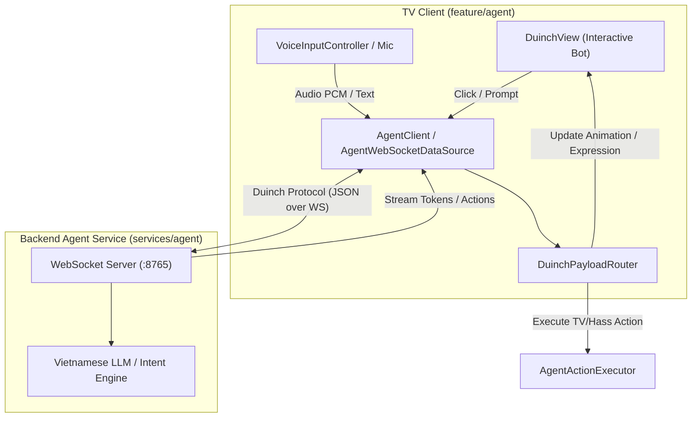

# AI Agent Module (`feature/agent/`)

The **Agent** module integrates an intelligent on-TV voice and chat assistant named **Duinch**. It allows users to ask questions, control the TV, execute smart home actions, and receive proactive suggestions via voice or remote control.

---

## 1. System Architecture

---

## 2. Key Components

### A. Bot & Interactive UI
- [`DuinchView.kt`](file:///Users/lap16792/Personal/tv-agent/tv-agent-launcher/apps/launcher/app/src/main/java/com/gathin/tvhome/feature/agent/ui/DuinchView.kt):
  Custom-drawn animated robot companion rendered on the launcher screen. Features multiple emotional expressions (`SURPRISED`, `WINK`, `EXCITED`, `HAPPY`, `THINKING`) using native Canvas paths.
- [`DuinchBrain.kt`](file:///Users/lap16792/Personal/tv-agent/tv-agent-launcher/apps/launcher/app/src/main/java/com/gathin/tvhome/feature/agent/ui/DuinchBrain.kt):
  Client-side brain determining contextual greetings, time-of-day phrases, and idle proactive suggestions.
- [`AgentActivity.kt`](file:///Users/lap16792/Personal/tv-agent/tv-agent-launcher/apps/launcher/app/src/main/java/com/gathin/tvhome/feature/agent/ui/AgentActivity.kt):
  Full-screen interactive conversational panel supporting live microphone input, rich markdown answers, and pairing QR codes.

### B. Networking & Protocol
- [`AgentClient.kt`](file:///Users/lap16792/Personal/tv-agent/tv-agent-launcher/apps/launcher/app/src/main/java/com/gathin/tvhome/feature/agent/datasource/AgentClient.kt):
  Manages WebSocket connections to the companion backend, featuring automatic reconnection, keep-alive heartbeats, and payload framing.
- [`DuinchPayloadRouter.kt`](file:///Users/lap16792/Personal/tv-agent/tv-agent-launcher/apps/launcher/app/src/main/java/com/gathin/tvhome/feature/agent/datasource/DuinchPayloadRouter.kt):
  Deserializes incoming agent payloads and routes them to greeting listeners, action executors, or notification dispatchers.
- [`AgentContracts.kt`](file:///Users/lap16792/Personal/tv-agent/tv-agent-launcher/apps/launcher/app/src/main/java/com/gathin/tvhome/feature/agent/model/AgentContracts.kt):
  Strict data contracts conforming to `packages/contract/contract.json` (`Intent`, `ActionPlan`, `ExecutionResult`, `PresentationResponse`).

### C. Voice & Remote Key Handling
- [`VoiceInputController.kt`](file:///Users/lap16792/Personal/tv-agent/tv-agent-launcher/apps/launcher/app/src/main/java/com/gathin/tvhome/feature/agent/ui/VoiceInputController.kt):
  Integrates with Android's `SpeechRecognizer` for real-time speech-to-text recognition.
- [`AgentAssistantShortcut.kt`](file:///Users/lap16792/Personal/tv-agent/tv-agent-launcher/apps/launcher/app/src/main/java/com/gathin/tvhome/feature/agent/ui/AgentAssistantShortcut.kt):
  Binds hardware assistant buttons (`KEYCODE_ASSIST` 219, `KEYCODE_VOICE_ASSIST` 231) on TV remotes to invoke the agent instantly.
