# Home Module (`feature/main/`)

The **Home** module is the central command center of `tv-agent-launcher`. It manages the TV home screen, application grid, bottom desktop dock, hero headers, dynamic wallpaper rotations, and input coordination.

---

## 1. Architecture & MainActivity Decoupling

Historically, `MainActivity.kt` was a monolithic class exceeding 2,900 lines of code. It has been refactored into a lean host of **272 lines**, delegating all UI responsibilities to 10 specialized Coordinators:

```mermaid
flowchart TD
    MA["MainActivity.kt (272 lines)<br>Lifecycle & Root ViewBinding"]
    
    MA --> MP["MainPresenter (MVI State)"]
    
    MA --> C1["HomeAppCoordinator<br>(App launching, system intents)"]
    MA --> C2["HomeGridCoordinator<br>(Grid navigation, tile clicks)"]
    MA --> C3["HomeHeaderCoordinator<br>(Greeting, Shamsi/Lunar date)"]
    MA --> C4["HomeHeroCoordinator<br>(Ambient spotlight, hero cards)"]
    MA --> C5["HomeThemeCoordinator<br>(Palette, background shaders)"]
    MA --> C6["HomeTvInputCoordinator<br>(HDMI input switcher)"]
    MA --> C7["HomeCardsCoordinator<br>(Card parsing & validation)"]
    MA --> C8["HomeAgentCoordinator<br>(Duinch proactive prompts)"]
    MA --> C9["WallpaperPlayer<br>(Live video/graphic wallpapers)"]
    MA --> C10["WallpaperRotation<br>(Wallpaper cycling & timers)"]
```

---

## 2. Key Components

### A. Presentation Layer (MVI)
- [`MainPresenter.kt`](file:///Users/lap16792/Personal/tv-agent/tv-agent-launcher/apps/launcher/app/src/main/java/com/gathin/tvhome/feature/main/presenter/MainPresenter.kt):
  Coordinates asynchronous intents (`MainIntent.LoadApps`, `MainIntent.SelectApp`, `MainIntent.SwitchDockMode`) and exposes `StateFlow<MainState>` and `SharedFlow<MainEffect>`.
- [`MainContracts.kt`](file:///Users/lap16792/Personal/tv-agent/tv-agent-launcher/apps/launcher/app/src/main/java/com/gathin/tvhome/feature/main/presenter/MainContracts.kt):
  Defines `MainIntent`, `MainState`, and `MainEffect`.

### B. Custom Views
- [`HomeGrid.kt`](file:///Users/lap16792/Personal/tv-agent/tv-agent-launcher/apps/launcher/app/src/main/java/com/gathin/tvhome/feature/main/widget/HomeGrid.kt):
  Custom TV-optimized RecyclerView providing smooth D-Pad focus transitions, custom layout managers, and scroll physics.
- [`BottomDockView.kt`](file:///Users/lap16792/Personal/tv-agent/tv-agent-launcher/apps/launcher/app/src/main/java/com/gathin/tvhome/feature/main/widget/BottomDockView.kt):
  A desktop-style floating bottom dock for pinned favorites, supporting live zoom animations and focus elevation.
- [`WidgetShelf.kt`](file:///Users/lap16792/Personal/tv-agent/tv-agent-launcher/apps/launcher/app/src/main/java/com/gathin/tvhome/feature/main/widget/WidgetShelf.kt):
  Modular widget container displaying weather, lunar calendar, smart home controls, and system stats.

### C. Adapter & Tile Model
- [`AppAdapter.kt`](file:///Users/lap16792/Personal/tv-agent/tv-agent-launcher/apps/launcher/app/src/main/java/com/gathin/tvhome/feature/main/adapter/AppAdapter.kt):
  DiffUtil-backed adapter for installed TV applications.
- [`AppTileItem.kt`](file:///Users/lap16792/Personal/tv-agent/tv-agent-launcher/apps/launcher/app/src/main/java/com/gathin/tvhome/feature/main/adapter/AppTileItem.kt):
  Model representing an individual app tile (label, banner, package name, pinned status).

---

## 3. Navigation Modes

The launcher supports two dynamic layout modes configured via Quick Settings:
1. **Standard TV Grid**: Full-screen grid optimized for 10-foot TV viewing with large app tiles and prominent category labels.
2. **Desktop Dock Mode**: Compact macOS/desktop style bottom dock, maximizing wallpaper visibility while keeping essential apps easily accessible.
