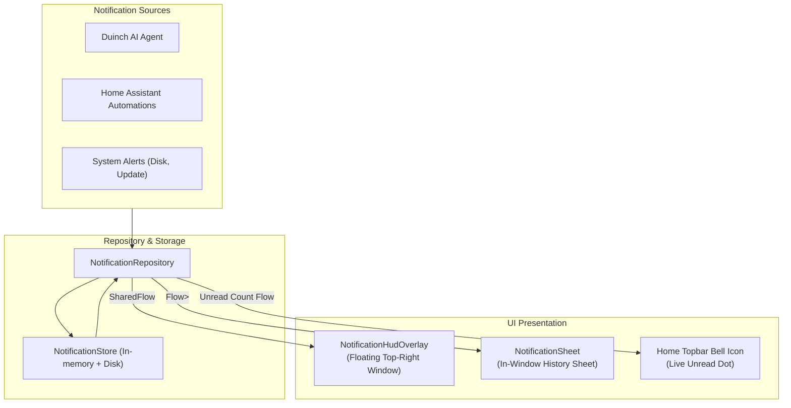

# Notification Module (`feature/notification/`)

The **Notification** module provides a centralized notification management center and a global heads-up display (HUD) banner for TV alerts.

---

## 1. Architectural Overview



---

## 2. Key Components

### A. Domain Entity
- [`TvNotification.kt`](file:///Users/lap16792/Personal/tv-agent/tv-agent-launcher/apps/launcher/app/src/main/java/com/gathin/tvhome/feature/notification/model/TvNotification.kt):
  Immutable domain model containing notification attributes:
  - `id`: Unique identifier (UUID).
  - `title`: Short summary line.
  - `message`: Descriptive message body.
  - `timestamp`: Epoch milliseconds.
  - `severity`: Visual severity level (`INFO`, `WARNING`, `ERROR`, `SUCCESS`).
  - `read`: Read/unread persistence status.
  - `action`: Optional deep-link intent or smart home action.

### B. Repository Layer
- [`NotificationRepository.kt`](file:///Users/lap16792/Personal/tv-agent/tv-agent-launcher/apps/launcher/app/src/main/java/com/gathin/tvhome/feature/notification/repository/NotificationRepository.kt):
  Interface exposing reactive state streams:
  ```kotlin
  interface NotificationRepository {
      fun getNotifications(): Flow<List<TvNotification>>
      suspend fun addNotification(notification: TvNotification)
      suspend fun markAsRead(id: String)
      suspend fun clearAll()
  }
  ```
- [`NotificationRepositoryImpl.kt`](file:///Users/lap16792/Personal/tv-agent/tv-agent-launcher/apps/launcher/app/src/main/java/com/gathin/tvhome/feature/notification/repository/NotificationRepositoryImpl.kt):
  Thread-safe singleton managing notification persistence across app restarts.

### C. Presentation & UI
- [`NotificationPresenter.kt`](file:///Users/lap16792/Personal/tv-agent/tv-agent-launcher/apps/launcher/app/src/main/java/com/gathin/tvhome/feature/notification/ui/NotificationPresenter.kt):
  MVI State holder managing list filtering, unread counting, and dismiss actions.
- [`NotificationSheet.kt`](file:///Users/lap16792/Personal/tv-agent/tv-agent-launcher/apps/launcher/app/src/main/java/com/gathin/tvhome/feature/notification/ui/NotificationSheet.kt):
  In-window side sheet displaying notification history grouped by date.
- [`NotificationHudOverlay.kt`](file:///Users/lap16792/Personal/tv-agent/tv-agent-launcher/apps/launcher/app/src/main/java/com/gathin/tvhome/feature/notification/ui/NotificationHudOverlay.kt):
  Lightweight window overlay appearing at the top-right corner of the TV screen when a high-priority alert arrives, auto-dismissing after a configurable timeout.
