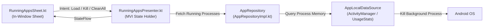

# Running Apps Module (`feature/runningapps/`)

The **Running Apps** module provides real-time monitoring of active background processes, RAM usage metrics, and a one-click memory optimization tool ("Clean RAM") essential for low-memory Android TV environments.

---

## 1. Architectural Flow



---

## 2. Key Components

### A. Domain Entity
- [`RunningAppItem.kt`](file:///Users/lap16792/Personal/tv-agent/tv-agent-launcher/apps/launcher/app/src/main/java/com/gathin/tvhome/feature/runningapps/model/RunningAppItem.kt):
  Represents an active application or background service:
  - `packageName`: Unique package identifier.
  - `label`: Human-readable application title.
  - `icon`: Application icon drawable.
  - `memoryBytes`: Memory consumed by this process in bytes.
  - `isSystemApp`: Flag indicating whether the app is a protected system service.

### B. Repository & Data Layer
- [`AppRepository.kt`](file:///Users/lap16792/Personal/tv-agent/tv-agent-launcher/apps/launcher/app/src/main/java/com/gathin/tvhome/feature/runningapps/repository/AppRepository.kt):
  Contract for inspecting and controlling system tasks:
  ```kotlin
  interface AppRepository {
      fun getRunningApps(): Flow<List<RunningAppItem>>
      suspend fun killApp(packageName: String): Result<Unit>
      suspend fun cleanAll(): Result<Long> // Returns freed bytes
  }
  ```

### C. Presentation & UI
- [`RunningAppsPresenter.kt`](file:///Users/lap16792/Personal/tv-agent/tv-agent-launcher/apps/launcher/app/src/main/java/com/gathin/tvhome/feature/runningapps/ui/RunningAppsPresenter.kt):
  MVI State holder managing asynchronous process scanning, sorting by memory footprint, and emitting progress events during memory cleanup.
- [`RunningAppsSheet.kt`](file:///Users/lap16792/Personal/tv-agent/tv-agent-launcher/apps/launcher/app/src/main/java/com/gathin/tvhome/feature/runningapps/ui/RunningAppsSheet.kt):
  In-window side sheet presenting the task list, active RAM progress bar, and "Clean RAM" button.
