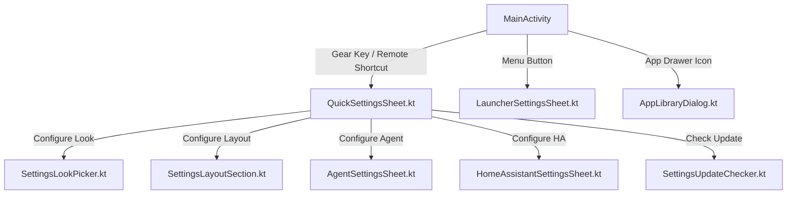

# Settings Module (`feature/settings/`)

The **Settings** module provides in-window configuration panels, full application management, and in-app over-the-air (OTA) updates.

---

## 1. Modular Settings Sheets

Rather than launching heavy separate Activities, all configuration screens run as lightweight in-window dialogs:

---

## 2. Key Components

### A. Settings Sheets
- [`QuickSettingsSheet.kt`](file:///Users/lap16792/Personal/tv-agent/tv-agent-launcher/apps/launcher/app/src/main/java/com/gathin/tvhome/feature/settings/ui/QuickSettingsSheet.kt):
  Fast-access side sheet triggered by the remote gear key. Houses toggles for layout mode (TV Grid vs Desktop Dock), theme look picker, and quick shortcuts.
- [`LauncherSettingsSheet.kt`](file:///Users/lap16792/Personal/tv-agent/tv-agent-launcher/apps/launcher/app/src/main/java/com/gathin/tvhome/feature/settings/ui/LauncherSettingsSheet.kt):
  Comprehensive launcher preferences (wallpaper rotation interval, clock format, screensaver timeout, hidden apps).
- [`AgentSettingsSheet.kt`](file:///Users/lap16792/Personal/tv-agent/tv-agent-launcher/apps/launcher/app/src/main/java/com/gathin/tvhome/feature/settings/ui/AgentSettingsSheet.kt):
  Configures the Duinch AI server endpoint, port, voice recognition model, and phone pairing QR code.
- [`HomeAssistantSettingsSheet.kt`](file:///Users/lap16792/Personal/tv-agent/tv-agent-launcher/apps/launcher/app/src/main/java/com/gathin/tvhome/feature/settings/ui/HomeAssistantSettingsSheet.kt):
  Manages Home Assistant connection parameters (URL, Long-Lived Access Token) and verifies live entity connectivity.

### B. Application Management
- [`AppLibraryDialog.kt`](file:///Users/lap16792/Personal/tv-agent/tv-agent-launcher/apps/launcher/app/src/main/java/com/gathin/tvhome/feature/settings/ui/AppLibraryDialog.kt):
  Full application drawer showing all installed user and system packages. Allows hiding apps from the main grid, viewing package information, and initiating uninstalls.
- [`AppLibraryCatalog.kt`](file:///Users/lap16792/Personal/tv-agent/tv-agent-launcher/apps/launcher/app/src/main/java/com/gathin/tvhome/feature/settings/ui/AppLibraryCatalog.kt):
  Scans and sorts installed packages via Android's `PackageManager`.

### C. In-App Updater
- [`SettingsUpdateChecker.kt`](file:///Users/lap16792/Personal/tv-agent/tv-agent-launcher/apps/launcher/app/src/main/java/com/gathin/tvhome/feature/settings/ui/SettingsUpdateChecker.kt):
  Queries GitHub releases asynchronously for updates.
- [`LauncherRelease.kt`](file:///Users/lap16792/Personal/tv-agent/tv-agent-launcher/apps/launcher/app/src/main/java/com/gathin/tvhome/feature/system/data/LauncherRelease.kt):
  Model representing published APK releases and semantic version parsing (`isNewer`).
- [`ReleaseInstaller.kt`](file:///Users/lap16792/Personal/tv-agent/tv-agent-launcher/apps/launcher/app/src/main/java/com/gathin/tvhome/feature/system/data/ReleaseInstaller.kt):
  Streams the release APK directly to disk with live progress callbacks and invokes Android's package installer.
