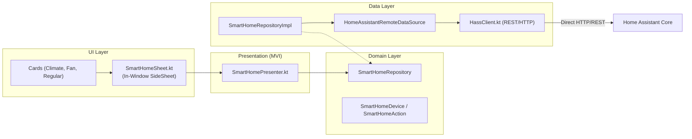

# Smart Home Module (`feature/smarthome/`)

The **Smart Home** module enables on-TV monitoring and control of domestic IoT devices through a direct, low-latency integration with **Home Assistant (Hass)**.

---

## 1. Architecture & Clean Architecture Separation

The smart home feature operates without intermediate server proxies, communicating directly from the TV to the local or remote Home Assistant instance:



---

## 2. Key Classes & Responsibilities

### A. Core Communication
- [`HassClient.kt`](file:///Users/lap16792/Personal/tv-agent/tv-agent-launcher/apps/launcher/app/src/main/java/com/gathin/tvhome/feature/smarthome/datasource/HassClient.kt):
  Lightweight HTTP client communicating with Home Assistant's REST API (`/api/states`, `/api/services`). It validates SSL, supports bearer token authentication, handles timeouts, and normalizes URLs.
- [`HomeAssistantRemoteDataSource.kt`](file:///Users/lap16792/Personal/tv-agent/tv-agent-launcher/apps/launcher/app/src/main/java/com/gathin/tvhome/feature/smarthome/datasource/HomeAssistantRemoteDataSource.kt):
  Transforms raw JSON responses into typed domain devices and maps actions (`toggle`, `set_temperature`, `set_fan_mode`).

### B. Domain & Repository
- [`SmartHomeDevice.kt`](file:///Users/lap16792/Personal/tv-agent/tv-agent-launcher/apps/launcher/app/src/main/java/com/gathin/tvhome/feature/smarthome/model/SmartHomeDevice.kt):
  Domain entity capturing device properties (entity ID, domain, state, friendly name, attributes, unit of measurement).
- [`SmartHomeRepository.kt`](file:///Users/lap16792/Personal/tv-agent/tv-agent-launcher/apps/launcher/app/src/main/java/com/gathin/tvhome/feature/smarthome/repository/SmartHomeRepository.kt):
  Abstract repository interface exposing reactive flows:
  ```kotlin
  interface SmartHomeRepository {
      fun getDevices(): Flow<List<SmartHomeDevice>>
      suspend fun executeAction(device: SmartHomeDevice, action: SmartHomeAction): Result<Unit>
      suspend fun refresh(): Result<Unit>
  }
  ```

### C. UI & Presentation
- [`SmartHomeSheet.kt`](file:///Users/lap16792/Personal/tv-agent/tv-agent-launcher/apps/launcher/app/src/main/java/com/gathin/tvhome/feature/smarthome/ui/SmartHomeSheet.kt):
  In-window modal sheet displaying categorized rooms and device cards.
- [`SmartHomePresenter.kt`](file:///Users/lap16792/Personal/tv-agent/tv-agent-launcher/apps/launcher/app/src/main/java/com/gathin/tvhome/feature/smarthome/ui/SmartHomePresenter.kt):
  MVI State holder managing device list loading, room grouping, and real-time state mutation.
- [`HassControls.kt`](file:///Users/lap16792/Personal/tv-agent/tv-agent-launcher/apps/launcher/app/src/main/java/com/gathin/tvhome/feature/smarthome/ui/HassControls.kt):
  UI helper creating D-Pad navigable control buttons styled with Material 3.

---

## 3. Supported Entity Domains

The smart home renderer classifies entities by domain:
- **`light` & `switch`**: Quick toggle switches with real-time brightness/power status.
- **`climate`**: Thermostat and AC controls (target temperature increment/decrement, HVAC mode).
- **`fan`**: Speed adjustments, oscillate toggle, on/off state.
- **`sensor`**: Temperature, humidity, power consumption, and air quality badges.
