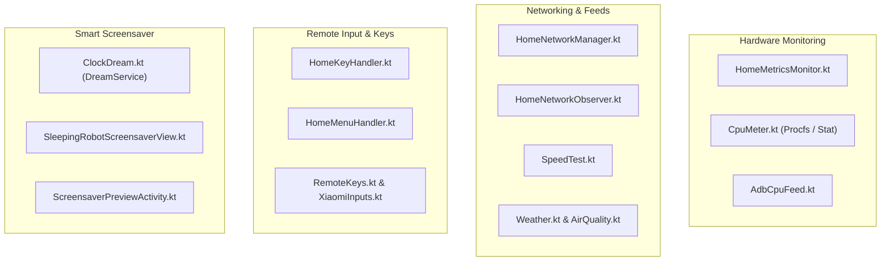

# System Module (`feature/system/`)

The **System** module interfaces with hardware, OS APIs, remote control keys, networking, and the smart screensaver.

---

## 1. System Subsystems

---

## 2. Key Components

### A. Hardware & Performance Monitoring
- [`HomeMetricsMonitor.kt`](file:///Users/lap16792/Personal/tv-agent/tv-agent-launcher/apps/launcher/app/src/main/java/com/gathin/tvhome/feature/system/monitor/HomeMetricsMonitor.kt):
  Periodically samples CPU utilization and RAM pressure. Runs off the main thread to prevent UI frame drops.
- [`CpuMeter.kt`](file:///Users/lap16792/Personal/tv-agent/tv-agent-launcher/apps/launcher/app/src/main/java/com/gathin/tvhome/feature/system/monitor/CpuMeter.kt):
  Reads `/proc/stat` and `/sys/devices/system/cpu` with permanent caching of core count and maximum frequencies.

### B. Network & Environmental Feeds
- [`HomeNetworkManager.kt`](file:///Users/lap16792/Personal/tv-agent/tv-agent-launcher/apps/launcher/app/src/main/java/com/gathin/tvhome/feature/system/network/HomeNetworkManager.kt):
  Monitors active network state (Ethernet / Wi-Fi signal strength, IP address, gateway).
- [`Weather.kt`](file:///Users/lap16792/Personal/tv-agent/tv-agent-launcher/apps/launcher/app/src/main/java/com/gathin/tvhome/feature/system/network/Weather.kt) & [`AirQuality.kt`](file:///Users/lap16792/Personal/tv-agent/tv-agent-launcher/apps/launcher/app/src/main/java/com/gathin/tvhome/feature/system/network/AirQuality.kt):
  Parses outdoor/indoor atmospheric conditions and exposes them for widget display.

### C. Remote Keys & Shortcuts
- [`HomeKeyHandler.kt`](file:///Users/lap16792/Personal/tv-agent/tv-agent-launcher/apps/launcher/app/src/main/java/com/gathin/tvhome/feature/system/key/HomeKeyHandler.kt):
  Central key interceptor handling back key double-presses, Home key fallback, and menu key triggers.
- [`XiaomiInputs.kt`](file:///Users/lap16792/Personal/tv-agent/tv-agent-launcher/apps/launcher/app/src/main/java/com/gathin/tvhome/feature/system/key/XiaomiInputs.kt) & [`RemoteKeys.kt`](file:///Users/lap16792/Personal/tv-agent/tv-agent-launcher/apps/launcher/app/src/main/java/com/gathin/tvhome/feature/system/key/RemoteKeys.kt):
  Normalizes vendor-specific keycodes across Sony Bravia, Xiaomi Mi TV, TCL, and generic Android TV remotes.

### D. AI Ambient Smart Screensaver
- [`ClockDream.kt`](file:///Users/lap16792/Personal/tv-agent/tv-agent-launcher/apps/launcher/app/src/main/java/com/gathin/tvhome/service/ClockDream.kt):
  Custom Android `DreamService` providing deep-ambient mode on OLED/LED panels:
  - Absolute black background (`#000000`) with lowest panel brightness (`isScreenBright = false`).
  - Animated sleeping robot companion ([`SleepingRobotScreensaverView`](file:///Users/lap16792/Personal/tv-agent/tv-agent-launcher/apps/launcher/app/src/main/java/com/gathin/tvhome/feature/system/screensaver/SleepingRobotScreensaverView.kt)).
  - Periodic burn-in protection via subtle pixel shifts.
